<picture><source media="(prefers-color-scheme: dark)" srcset="assets/hero-dark.svg"></picture>

<picture><source media="(prefers-color-scheme: dark)" srcset="assets/about-dark.svg"></picture>

<a href="https://github.com/Begitdj/cve-2019-2215-markw"><picture><source media="(prefers-color-scheme: dark)" srcset="assets/project-cve-2019-2215-markw-dark.svg"></picture></a>&nbsp;<a href="https://github.com/Begitdj/android_kernel_xiaomi_mt6785"><picture><source media="(prefers-color-scheme: dark)" srcset="assets/project-android-kernel-xiaomi-mt6785-dark.svg"></picture></a>

<a href="https://github.com/Begitdj/WindYM"><picture><source media="(prefers-color-scheme: dark)" srcset="assets/project-windym-dark.svg"></picture></a>&nbsp;<a href="https://github.com/Begitdj/YaGent"><picture><source media="(prefers-color-scheme: dark)" srcset="assets/project-yagent-dark.svg"></picture></a>

<a href="https://github.com/Begitdj/Redwood-scarlet-resukisu"><picture><source media="(prefers-color-scheme: dark)" srcset="assets/project-redwood-scarlet-resukisu-dark.svg"></picture></a>&nbsp;<a href="https://github.com/Begitdj/NekoBoxForAndroid"><picture><source media="(prefers-color-scheme: dark)" srcset="assets/project-nekoboxforandroid-dark.svg"></picture></a>

<picture><source media="(prefers-color-scheme: dark)" srcset="assets/stats-dark.svg"></picture>

<picture><source media="(prefers-color-scheme: dark)" srcset="assets/wave-dark.svg"></picture>

<a href="https://metawka.github.io/expressive-profile/?from=begitdj"><picture><source media="(prefers-color-scheme: dark)" srcset="assets/credit-dark.svg"></picture></a>

